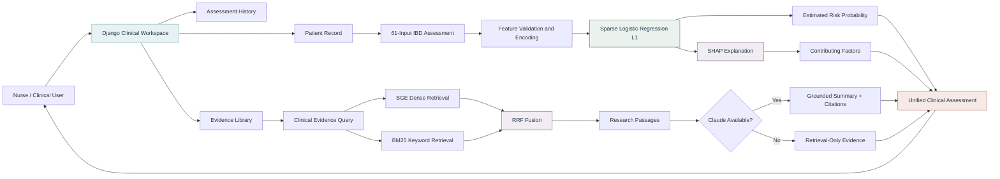
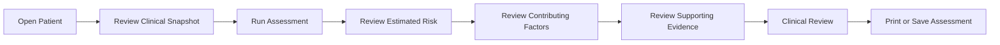
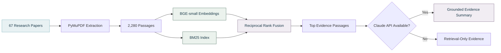

<div align="center">

# IBD Care

### Inflammatory Bowel Disease Risk Assessment & Clinical Decision Support

A nurse-focused clinical decision-support prototype combining **interpretable machine learning**, **patient-level explainability**, and **evidence-grounded research retrieval**.

**Nursing Innovation Hackathon 2026 · Team NH-74 · Track 3 — AI-Driven Clinical Decision Support**

<br>

[](https://ibd-care-demo.onrender.com)
[](https://www.python.org/)
[](https://www.djangoproject.com/)
[](https://shap.readthedocs.io/)

<br>

**Demo username:** `nurse`  
**Demo password:** `nurse-demo26`

</div>

---

## Overview

**IBD Care** is a clinical decision-support prototype designed to help nurses review patient information, estimate inflammatory bowel disease risk, understand the major factors influencing the estimate, and access supporting clinical literature within one workflow.

The system follows a **Human-Centered AI** approach:

- The nurse remains the final decision-maker.
- The system communicates **estimated risk, not diagnosis**.
- Patient-level explanations are provided for every assessment.
- Supporting evidence can be reviewed when needed.
- Technical implementation details are kept outside the primary nursing workflow.
- Safety and synthetic-data limitations remain transparent.

> **Clinical Safety Notice**  
> IBD Care is a demonstration prototype built using synthetic patient data. It is **not validated for clinical use**, does **not provide a diagnosis**, and must not be used independently to guide treatment.

---

## Project at a Glance

| Component | Details |
|---|---|
| **Primary User** | Nurses and clinical care teams |
| **Clinical Focus** | Early IBD risk assessment |
| **Dataset** | 2,500 synthetic patient records |
| **Model Inputs** | 61 structured features |
| **Selected Model** | Sparse Logistic Regression (L1) |
| **Explainability** | SHAP-based patient-level explanation |
| **Evidence System** | Hybrid RAG |
| **Research Corpus** | 67 papers / 2,280 indexed passages |
| **Web Framework** | Django 5.2 |
| **Deployment** | Render |

---

## Technology Stack

[](https://www.python.org/)
[](https://www.djangoproject.com/)
[](https://scikit-learn.org/)
[](https://shap.readthedocs.io/)
[](https://pandas.pydata.org/)
[](https://numpy.org/)
[](https://www.anthropic.com/)
[](https://render.com/)

| Layer | Technology |
|---|---|
| Language | Python 3.11 |
| Web Application | Django 5.2 |
| Frontend | Django Templates, HTML, CSS, JavaScript |
| Database | SQLite + Django ORM |
| Data Processing | Pandas, NumPy |
| Machine Learning | scikit-learn |
| Explainability | SHAP |
| Model Storage | Joblib |
| PDF Processing | PyMuPDF |
| Dense Retrieval | FastEmbed |
| Embedding Model | BAAI/bge-small-en-v1.5 |
| Sparse Retrieval | BM25 |
| Rank Fusion | Reciprocal Rank Fusion |
| Evidence Generation | Anthropic Claude |
| Spreadsheet Processing | OpenPyXL |
| Deployment | Render |

---

# System Architecture



---

## Clinical Workflow



The system intentionally keeps **human clinical review after the AI output**.

---

# Machine Learning Pipeline

## Dataset

The current prototype uses:

`Saudi_IBD_Synthetic.xlsx`

| Property | Value |
|---|---:|
| Patient records | **2,500** |
| Synthetic IBD prevalence | **24.7%** |
| Model inputs | **61** |
| Feature groups | **10** |
| Training split | **80%** |
| Held-out test split | **20%** |
| Held-out records | **500** |
| Random seed | **42** |

### Feature Groups

| Group | Examples |
|---|---|
| Demographics | Age, sex, BMI |
| Family History | IBD family history |
| Diet | Fiber, fast food, ultra-processed food |
| Lifestyle | Stress, sleep, activity, smoking |
| Medication | Antibiotics, PPI, NSAIDs |
| Early Life | Birth mode, breastfeeding |
| Microbiome | Shannon diversity, Faecalibacterium, Proteobacteria |
| Inflammatory Biomarkers | Fecal calprotectin, CRP, vitamin D |
| Metabolic Biomarkers | Butyrate and tryptophan-related markers |
| Red Flags | Clinical and surgical risk flags |

---

## Leakage Prevention

The following variables are excluded from the model input:

- Patient identifier
- Target label
- Synthetic risk probability
- Composite dysbiosis score
- Microbial risk score
- Metabolomic risk score

This prevents direct leakage from variables used during synthetic data generation.

---

## Model Selection

Several models were evaluated:

| Model | Purpose |
|---|---|
| Logistic Regression L2 | Linear baseline |
| **Sparse Logistic Regression L1** | Selected model |
| Logistic Regression + Splines | Non-linear variant |
| Random Forest | Tree ensemble |
| HistGradientBoosting | Gradient boosting |
| Ensemble | Combined candidate |

Model selection used:

**Nested 5-fold cross-validation**

Primary selection metric:

**PR-AUC**

### Selected Model

**Sparse Logistic Regression with L1 regularization**

```text
C = 0.3
```

The model was selected because it provides a strong balance between:

- predictive performance;
- interpretability;
- sparse feature weighting;
- clinical transparency.

---

## Risk Decision Logic

Classification threshold:

```text
0.454
```

Risk categories:

| Risk Level | Estimated Probability |
|---|---:|
| Low | `< 20%` |
| Moderate | `20% – < 50%` |
| High | `≥ 50%` |

The interface presents this as an **estimated IBD risk**, not a diagnosis.

---

# Model Evaluation

> These metrics describe performance on the synthetic dataset and **must not be interpreted as validated clinical diagnostic accuracy**.

| Metric | Result |
|---|---:|
| ROC-AUC | **0.972** |
| PR-AUC | **0.925** |
| Accuracy | **0.902** |
| Precision | **0.800** |
| Recall / Sensitivity | **0.806** |
| Specificity | **0.934** |
| F1 Score | **0.803** |
| NPV | **0.936** |
| Brier Score | **0.059** |

---

# Explainable AI

[](https://shap.readthedocs.io/)

IBD Care uses SHAP-based explanations to show which recorded factors influenced each assessment.

The nurse-facing interface does not expose raw SHAP values.

Instead, explanations are grouped into:

| Direction | Meaning |
|---|---|
| **Increasing estimated risk** | Factors pushing the model estimate upward |
| **Reducing estimated risk** | Factors pushing the model estimate downward |

Examples of influential model features include:

`fecal calprotectin`  
`fecal butyrate`  
`Shannon diversity`  
`antibiotic exposure`  
`fiber intake`  
`Proteobacteria abundance`  
`fast-food frequency`

These explanations describe **model behavior**, not biological causality.

---

# Evidence-Grounded RAG

The evidence system is separate from the machine-learning classifier.

> **The ML model estimates risk. The RAG system retrieves and summarizes supporting research.**

The language model does **not** generate the risk score.

---

## RAG Architecture



---

## Research Corpus

| Component | Value |
|---|---:|
| Full-text papers | **67** |
| Indexed passages | **2,280** |
| Chunk size | **300 words** |
| Chunk overlap | **60 words** |
| Minimum chunk | **40 words** |

Metadata retained:

- Paper title
- Publication year
- DOI
- Page number
- PDF filename

---

## Hybrid Retrieval

### Dense Retrieval

[](https://github.com/qdrant/fastembed)

Used to retrieve passages based on **semantic similarity**.

### Sparse Retrieval

[](#)

Used to identify exact biomedical terminology and biomarker names.

### Rank Fusion

[](#)

Dense and sparse rankings are combined using **Reciprocal Rank Fusion**.

---

## Claude Integration

When `ANTHROPIC_API_KEY` is available, retrieved passages are sent to Claude to generate concise grounded summaries.

Claude is instructed to:

- answer only from retrieved literature;
- cite factual claims;
- avoid diagnosis;
- distinguish synthetic model output from research evidence;
- indicate weak or mixed evidence;
- write for nurses and clinicians.

Without an API key, the application automatically switches to:

**Retrieval-Only Evidence Mode**

---

# Clinical Application

## Overview

Provides:

- total patient records;
- completed assessments;
- current risk distribution;
- latest high-risk cases;
- priority review access.

---

## Patient Directory

Provides:

- patient search;
- risk-level filtering;
- add-patient workflow;
- dedicated patient records.

---

## Patient Record

The dedicated patient page includes:

- latest estimated risk;
- latest assessment date;
- key biomarkers;
- family history;
- antibiotic exposure;
- clinical flags;
- assessment history;
- estimated risk over time.

---

## Assessment

The 61 inputs are divided into six nurse-facing sections:

1. Patient profile
2. Clinical history
3. Lifestyle and diet
4. Biomarkers
5. Microbiome
6. Red flags and surgical history

---

## Assessment Result

The saved assessment itself acts as the clinical report.

It includes:

- patient identity;
- assessment date;
- estimated IBD risk;
- risk level;
- visual risk scale;
- contributing-factor visualization;
- previous-assessment comparison;
- suggested next step;
- supporting research evidence;
- Print / Save PDF.

---

## Evidence Library

Allows nurses and clinicians to search the curated IBD research corpus without exposing technical RAG terminology in the primary interface.

---

## About

Centralizes:

- intended use;
- clinical safety;
- synthetic-data notice;
- validation status;
- human oversight;
- technical transparency.

---

# Human-Centered AI

IBD Care follows Human-Centered AI principles.

| Principle | Implementation |
|---|---|
| Human Control | Nurses and clinicians retain final judgment |
| Explainability | Patient-specific contributing factors are shown |
| Progressive Disclosure | Technical detail appears only when needed |
| Uncertainty Awareness | Results are presented as estimated risk |
| Evidence Access | Findings can be linked to supporting literature |
| Automation-Bias Reduction | Model estimate and clinical interpretation remain separate |
| Safety Transparency | Synthetic-data and validation limits remain visible |

---

# Project Structure

```text
IBD/
│
├── artifacts/
│   ├── model.joblib
│   ├── model_report.md
│   ├── roc_pr.png
│   ├── calibration.png
│   └── shap_summary.png
│
├── Full text article/
│
├── rag/
│   ├── ingest.py
│   ├── index.py
│   ├── retrieve.py
│   ├── evidence.py
│   └── llm.py
│
├── rag_index/
│   ├── embeddings.npy
│   ├── chunks.jsonl
│   └── docs.json
│
├── webapp/
│   ├── clinic/
│   │   ├── templates/
│   │   ├── static/
│   │   ├── management/
│   │   ├── models.py
│   │   ├── services.py
│   │   └── views.py
│   └── manage.py
│
├── Saudi_IBD_Synthetic.xlsx
├── IBD_Risk_Model.ipynb
├── features.py
├── train.py
├── predict.py
├── explain.py
├── example_patient.json
├── requirements.txt
├── .env.example
└── README.md
```

---

# Run Locally

<details open>
<summary><b>1. Clone the Repository</b></summary>

```bash
git clone https://github.com/ghaida-alsalamah/IBD.git
cd IBD
```

</details>

<details open>
<summary><b>2. Create a Virtual Environment</b></summary>

```bash
python -m venv .venv
```

Windows PowerShell:

```powershell
.\.venv\Scripts\Activate.ps1
```

macOS / Linux:

```bash
source .venv/bin/activate
```

</details>

<details open>
<summary><b>3. Install Dependencies</b></summary>

```bash
python -m pip install --upgrade pip
pip install -r requirements.txt
```

</details>

<details open>
<summary><b>4. Prepare Django</b></summary>

```bash
cd webapp
python manage.py migrate
python manage.py load_patients --demo-user --password nurse-demo26
```

</details>

<details>
<summary><b>5. Build the Evidence Index</b></summary>

```bash
python manage.py build_index
```

This builds:

- research-paper passages;
- BGE embeddings;
- BM25 index;
- hybrid retrieval index.

</details>

<details open>
<summary><b>6. Run the Application</b></summary>

```bash
python manage.py runserver
```

Open:

```text
http://127.0.0.1:8000/
```

Demo credentials:

```text
Username: nurse
Password: nurse-demo26
```

</details>

---

# Optional Claude Configuration

Claude is **not required for risk prediction**.

It is used only for grounded evidence summaries.

Add the following to `.env`:

```env
ANTHROPIC_API_KEY=your_key_here
```

Without this key, the Evidence Library automatically uses retrieval-only mode.

> Never commit API keys or `.env` files to GitHub.

---

# Testing

| Validation | Result |
|---|---:|
| Django tests | **35 passing** |
| Expanded-layout checks | **56** |
| Collapsed-layout checks | **39** |
| Long-page scroll checks | **48** |
| PDF output | **Reviewed** |

Run:

```bash
cd webapp
python manage.py test clinic
```

---

# Deployment

<div align="center">

[](https://ibd-care-demo.onrender.com)

### https://ibd-care-demo.onrender.com

</div>

Demo login:

```text
Username: nurse
Password: nurse-demo26
```

---

# Responsible AI & Clinical Safety

<details>
<summary><b>Current Prototype Limitations</b></summary>

- Patient records are synthetic.
- Model performance is not clinical validation.
- SHAP explanations describe model behavior, not biological causality.
- The evidence library is curated but not exhaustive.
- Retrieval may miss relevant evidence.
- Generated summaries require human review.
- The system must not independently guide diagnosis or treatment.

</details>

<details>
<summary><b>Requirements Before Real Clinical Use</b></summary>

- Validation on representative real Saudi patient data
- Prospective clinical evaluation
- Regulatory and clinical governance review
- Privacy and security assessment
- Bias and subgroup evaluation
- Calibration and drift monitoring
- Approved clinical/EHR integration
- Formal nurse usability testing

</details>

---

# Future Work

| Area | Future Direction |
|---|---|
| Clinical Validation | Validate on a larger real Saudi cohort |
| Hospital Integration | Connect with EHR systems |
| Monitoring | Add model calibration and drift monitoring |
| Evidence | Expand microbiome and biomarker literature |
| Security | Production authentication and audit logging |
| Database | Move to production-grade persistent storage |
| Usability | Conduct formal nurse usability studies |
| Longitudinal Care | Expand repeated-assessment monitoring |

---

# Hackathon Context

| | |
|---|---|
| **Event** | Nursing Innovation Hackathon 2026 |
| **Hackathon ID** | NH-74 |
| **Track** | Track 3 — AI-Driven Clinical Decision Support |
| **Project** | Machine Learning-Based Prediction of Inflammatory Bowel Disease Risk Using Gut Dysbiosis Biomarkers in Saudi Youth |

---

<div align="center">

# IBD Care

**Information · Understanding · Care**

[](https://ibd-care-demo.onrender.com)

</div>
